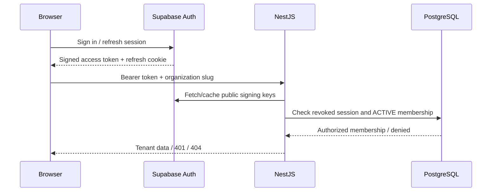

# ADR 0001: Supabase identity, NestJS authorization, Prisma persistence

Status: accepted for OPS-003.

## Decision

Supabase Auth owns passwords, email confirmation, identity and refresh tokens. Next.js uses the Supabase browser/SSR clients and a cookie-refresh Proxy. Next.js route guards verify claims before rendering protected pages.

NestJS independently verifies every protected bearer token against the Supabase project's public JWKS. It requires the authenticated audience/role, valid subject/session UUIDs and token expiry, rejects anonymous identities, and checks application session revocation. Organization operations then query Prisma for an ACTIVE membership and exclude deactivated users and archived organizations. Roles are derived from database membership; client metadata never grants access.

PostgreSQL and the OPS-002 Prisma models remain the system of record. Organization and owner-membership creation is transactional. Application tables have RLS without browser policies; browsers use Supabase Auth and access application data through NestJS.

## Consequences

- Identity can evolve independently of the business authorization rules.
- Web checks improve navigation; the API remains the authorization boundary for every client.
- Asymmetric signing is required (ES256 or RS256); legacy shared-secret signing must be migrated before using this verifier.
- Immediate OpsPilot logout revocation costs one indexed database read per protected request. Tombstones remain indefinitely so refreshed tokens cannot restore a revoked session.
- Logout covers the current session through OpsPilot. Supabase dashboard sign-out and other devices require additional revocation integration if the product later needs those guarantees.
- A provider/network failure fails closed. The UI shows a recoverable service error without granting access.
- The portfolio milestone is the demonstrated sign-up/confirmation/sign-in/workspace/refresh/sign-out workflow, backed by tenant-isolation tests.
